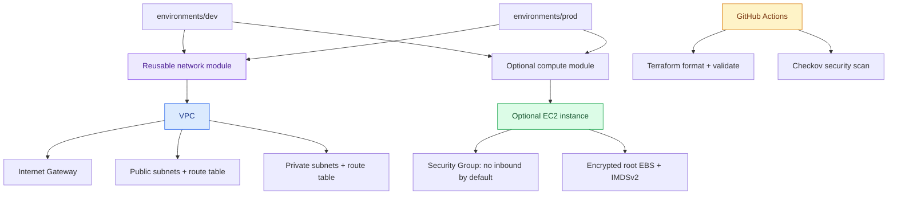
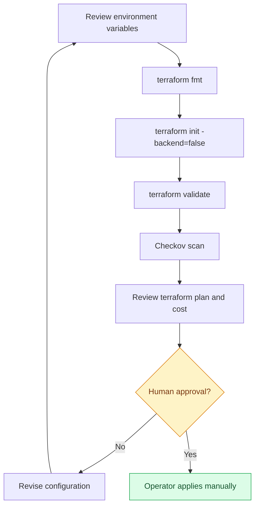

<div align="center">

# ☁️ Terraform AWS Infrastructure

**Reusable, environment-aware Infrastructure as Code with security-conscious defaults**

[](https://github.com/ABHILASH9519/Infrastructure-as-Code-with-Terraform-and-AWS/actions/workflows/terraform-checks.yml)


[Architecture](#-architecture) · [Provisioning flow](#-provisioning-flow) · [Quick start](#-quick-start) · [Security](#-safety-defaults)

</div>

---

Reusable, environment-aware AWS infrastructure using Terraform. This repository is designed to be reviewed and validated before any human-approved deployment.

## ✨ Capabilities

- Reusable VPC module with public/private subnets, route tables and internet gateway
- Optional EC2 module with no public IP, required IMDSv2 and encrypted root EBS
- Separate development and production root modules
- Input validation for CIDR syntax, subnet/AZ list lengths and optional EC2 AMI
- GitHub Actions formatting and validation for both environments
- Checkov security scan (currently advisory/soft-fail)

## 🧭 Architecture



## 🔄 Provisioning flow



## ⚡ Quick start

Prerequisites: Terraform >= 1.6, AWS CLI v2 and a deliberately selected AWS account/profile.

```bash
terraform -chdir=environments/dev init
terraform -chdir=environments/dev fmt -check -recursive
terraform -chdir=environments/dev validate
terraform -chdir=environments/dev plan
```

Review the plan and estimated costs. Do not apply without approval. CI never runs `terraform apply` and does not deploy resources.

## 🛡️ Safety defaults

- EC2 is disabled by default.
- No public IP is assigned to the optional instance.
- IMDSv2 is required and the root volume is encrypted.
- Inbound security-group rules are empty unless HTTPS CIDRs are explicitly configured.
- No NAT gateway is provisioned by default.
- Credentials, state and plan files must stay out of Git.

## 📚 Documentation

- [Architecture and module contracts](docs/architecture.md)
- [Operations checklist](docs/operations.md)
- [Cost and change controls](docs/cost-control.md)
- [Security notes](docs/security.md)

The production root is an educational starting point, not a production certification. Account-specific deployment, costs, IAM, remote state, monitoring, backup and disaster recovery still require deliberate configuration and review.
