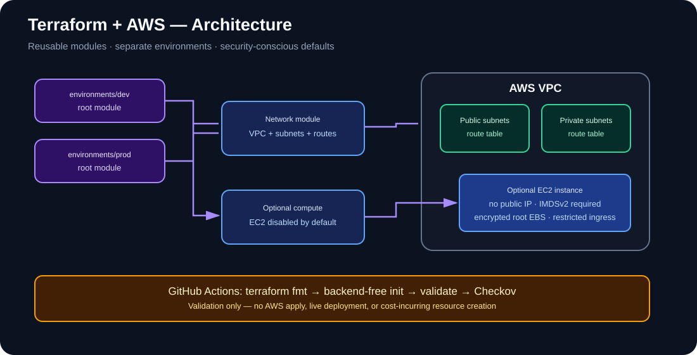
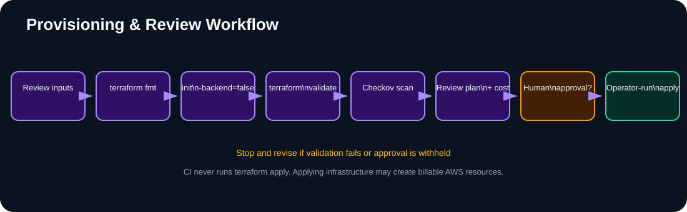

# Architecture and module contracts

Diagrams are embedded as standalone SVG files for consistent rendering in Markdown viewers.

## Environment roots

`environments/dev` and `environments/prod` are separate Terraform root modules. Each selects the AWS provider region, supplies environment-specific CIDR ranges and tags, and composes reusable modules.

## Network module

- Creates a VPC, public and private subnets, an internet gateway, route tables and associations.
- Requires equal, non-zero counts of availability zones, public subnets and private subnets.
- Validates CIDR input syntax before AWS API calls.
- Does not create a NAT gateway; private subnets therefore do not automatically have outbound internet access.

## Compute module

- Is opt-in through the environment variable `enable_ec2` (false by default).
- Places the instance in the selected subnet without a public IP.
- Requires IMDSv2, encrypts the root EBS volume and uses a security group with no inbound rules unless explicit HTTPS CIDRs are configured.
- The supplied subnet ID must exist in the selected AWS account and region. The AMI must be valid for that region.

## Architecture diagram

[Open system architecture diagram](images/system-architecture.svg)

## Provisioning and review workflow

[Open workflow diagram](images/provisioning-workflow.svg)

## Trust boundaries and limitations

CI runs formatting, backend-free initialization, validation and a soft-fail Checkov scan. It does not authenticate to AWS, create a plan against a live account, apply infrastructure or prove that an account-specific deployment will succeed. The prod root is a starting point and is not a production certification.
